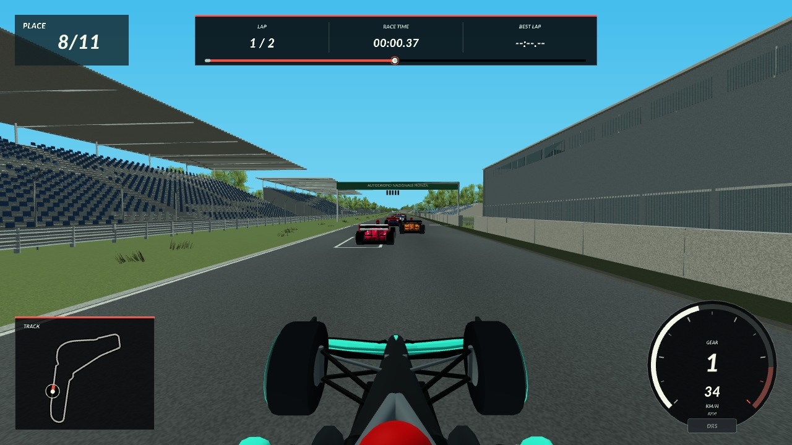

# Monza in the game

Run `make run` from the repository root and select Monza. The game loads this
directory's `monza.glb` and the route generated from the same reconstruction.



## What is integrated

The 5,793 m route replaces the previous diagram-based Monza. Its elevation,
width, crossfall, corner locations, runoff zones, minimap and starting grid
follow the reconstructed layout. Existing corner speed and gear targets have
been moved to the corresponding new locations. Vehicle tuning, transmission,
AI steering logic and lap-time acceptance limits have not been retuned.

The environment includes the pit complex, grandstands, bridges, historic oval,
service roads, barriers, fencing and all 14,958 placed trees from the Blender
scene. Eleven painted grid boxes match the game's existing spawn spacing.
The source `monza_reconstruction.blend` is preserved byte for byte.

The runtime conversion uses three baked intersecting cards per tree, textured
fence wire and reduced seat, tyre and grass detail. These are deliberate game
representations of the authored scene. Blender's full node materials are
converted to textured materials supported by the existing game shader, so the
game does not reproduce the Cycles lighting or every source material effect.
The renderer culls spatial mesh batches outside the camera and draws visible
batches from near to far. Mipmaps and anisotropic filtering reduce shimmer.

| Export measurement | Value |
| --- | ---: |
| GLB size | 100,077,116 bytes |
| Triangles | 1,295,635 |
| Spatial/material meshes | 2,188 |
| Native alignment samples | 1,536 |
| Maximum centerline plan error | 0.11423 m |
| Maximum centerline height error | 0.00110 m |
| Maximum road width error | 0.00088 m |

Blender metres map from `(x, y, z)` to glTF `(x, z, -y)`. The game applies
a uniform render scale of 1.445, corresponding to its existing 17 simulation
units per metre and 0.085 render scale. The native road datum accounts for the
game's 0.06 m surface offset. `monza.json` records the source hash and mapping;
`validation.json` records the measured alignment.

## Review and remaining failures

All 72 game-camera positions were rendered and inspected after integration.
The review checked road continuity, grounded scenery, foliage transparency,
bridge clearance, grid paint and the transition back to the pit straight.
These are staged T-cam checkpoints with 45 simulation frames at each position,
not a continuously driven lap. The source Blender's continuous inspection
remains available in [the authoring QA](../QA.md).

- [Start, Rettifilo and Curva Grande](qa/tour_1.jpg)
- [Roggia, Lesmos and Serraglio](qa/tour_2.jpg)
- [Serraglio, Ascari and back straight](qa/tour_3.jpg)
- [Alboreto and pit straight](qa/tour_4.jpg)

The full CTest suite passes 33 of 37 tests. Asset loading, track geometry,
grid alignment, collisions, vehicle dynamics, physics parity, time trial,
Monza racecraft and Monza competition checks pass. Four Monza checks fail:

| Check | Observed failure |
| --- | --- |
| `ai_monza_pace_audit` | Flying lap 78.4583 s exceeds the old 66–69 s target range. |
| `ai_monza_race_pace_audit` | Mean lap 78.5432 s exceeds the planner estimate of 75.8041 s by 3.61%. |
| `handling_dynamics_audit` | The audit driver gets stuck at the tighter first chicane; controlled-road and corner-proof checks fail. |
| `ai_monza_race_flat_commitment` | The race-start scenario records throttle lifts and 18 contacts. |

These failures remain visible in [the complete CTest log](qa/ctest.log).
The AI pace replay completes two laps without barrier contacts or progress
jumps, but the historical driving benchmarks are not validated for this layout.
The handling audit's acceleration, braking, grip and gear-map checks pass.
Further driving or AI calibration needs separate work; these failures are not
evidence that the complete gameplay regression suite passes.

The offscreen performance audit also misses the existing 19.2 ms p95 limit.
The measured 490-frame run is p50 21.8946 ms, p95 23.9538 ms and maximum
27.7337 ms. See [the performance log](qa/performance.log). This measurement
does not establish performance on other graphics hardware.

## Regenerate and verify

The Blender scene and checked-in survey are local inputs; exports do not fetch
new map data. Run these commands from the repository root:

```sh
uv sync --frozen
uv run --no-sync python tools/blender/tracks/export_monza_runtime.py
make
uv run --no-sync python tools/blender/tracks/verify_tracks.py --track monza
SDL_VIDEODRIVER=offscreen ctest --test-dir build/game --output-on-failure
SDL_VIDEODRIVER=offscreen build/game/formula_forge --capture-monza-tour
SDL_VIDEODRIVER=offscreen build/game/formula_forge --monza-perf-audit
```

`generate_tracks.py --track monza` calls the same exporter. The first export
bakes the foliage atlas through Blender; subsequent exports reuse it while the
source scene hash matches. The exporter also rewrites
`src/track_data/monza_survey.inc`. Rebuild the game before checking native
alignment. The survey supplies route data, so manual curve edits in Blender
must also be reflected in the survey before re-exporting.

Capture PNGs are written under `build/playtest_frames/` with the prefix
`formula_forge_monza_tour_`. CTest and the performance audit return nonzero
for the failures recorded above.

Geographic data copyright OpenStreetMap contributors, ODbL 1.0.
See [source provenance and accuracy limits](../references/SOURCES.md).
